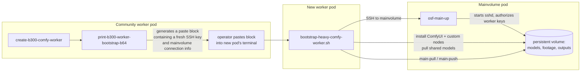

# Runpod Pod Orchestration

**Historical, security-sensitive code, not a current deployment recipe.**
These scripts were used with root SSH access, a potentially **reused worker
private key**, and a `chmod -R 777` writeback tree. The generated bootstrap
commands may expose real SSH/Hugging Face credentials in terminal output.
Read [Security boundaries](docs/SECURITY_BOUNDARIES.md) before running
anything. This repository's CI is offline and does **not** certify that a
deployed pod is secure.

Shell scripts Open Source Films (OSF) built to run a multi-pod Runpod setup for
GPU-heavy ComfyUI video work: one persistent "mainvolume" pod holding shared
storage and models, and one or more worker pods that attach to it over SSH,
install a GPU workload, and pull/push data and results.

This is not a general-purpose orchestration framework. It is the actual
scripts OSF ran in production between April and May 2026 to solve a specific,
recurring problem: standing up a fresh Runpod GPU worker quickly, pointed at
shared models and a shared output location, without re-downloading
multi-gigabyte checkpoints every time.

## Architecture



Three parts, each a separate script set:

1. **`osf_pod_link/`** — runs on the mainvolume pod. Starts `sshd`, keeps
   `authorized_client_keys` deduplicated, discovers the pod's own Runpod
   networking (pod ID, public IP, SSH proxy port) from Runpod's own
   environment variables, and writes that out to `main.env` so other scripts
   on the same pod can find it.
2. **`community_worker/`** — runs on the mainvolume pod (or wherever an
   operator has shell access) to prepare a new worker. Generates a
   self-contained, paste-into-a-fresh-pod's-terminal bootstrap block: a
   throwaway SSH key pair for that worker, the mainvolume connection details,
   and (optionally) the HuggingFace token needed for model downloads.
3. **`worker_bootstrap/`** — runs on the new worker pod once the pasted block
   above executes. Installs system packages, clones the ComfyUI variants OSF
   actually uses (a general install, WAN VACE, VideoMaMa, and optionally an
   isolated EffectErase runtime), links them to a shared model directory,
   pulls or downloads the model weights each variant needs, and writes launch
   scripts (`start-comfy-general`, `start-comfy-wan`, `start-comfy-videomama`)
   plus small `main-*` helper commands (`main-pull`, `main-push`, `main-ls`,
   `main-find`, `main-du`, `main-test-link`) for moving data to and from the
   mainvolume pod over SSH/rsync.

## A real Runpod constraint this was built around

Runpod's B300 GPU tier could not be launched through the Runpod REST API at
the time this was built — only through the web UI. `create-b300-comfy-worker`
states this plainly and routes around it: it generates the bootstrap paste
block via `print-b300-worker-bootstrap-b64` regardless, so the only manual
step left is launching the pod itself in the UI, everything after that is
scripted. See `RUNPOD.md` for the rest of the constraints and workarounds
found while building this.

## What this is not

This is not a polished, general-purpose Runpod orchestration library. It has
no config file format, no retry logic beyond what a few commands already have
built in, and it assumes the specific `/workspace/_osf_pod_link`,
`/workspace/_worker_bootstrap`, `/workspace/_community_worker` directory
layout the scripts reference each other by (see "Known limitations" in
`RUNPOD.md`). It is published because it is real, working infrastructure that
demonstrates how OSF actually used Runpod compute day to day, not because it
is meant to be a drop-in tool for another team's different setup.

## Repository layout

```
osf_pod_link/       mainvolume-side: SSH endpoint + worker-key authorization
worker_bootstrap/    worker-side: ComfyUI install + model provisioning
community_worker/    mainvolume-side: generates the worker bootstrap paste block
examples/             placeholder config files showing the expected shapes
tests/selfcheck.sh    syntax + no-committed-secrets check
```

## What is deliberately excluded

- Real pod IDs, IPs, hostnames, and SSH host keys from the pods this actually
  ran on — `examples/main.env.example` shows the shape with placeholders only.
- Real SSH keys, in any form — `examples/authorized_client_keys.example` uses
  fabricated key material, not a real public key.
- Any HuggingFace token or other credential. These scripts read secrets from
  files/environment variables at runtime (`HF_TOKEN`,
  `/workspace/_secrets/hf_token`, `OSF_MAIN_SSH_KEY_B64`) and never contain a
  real value in source.

For an **offline, synthetic-tested GPU-placement planner**, see
[the fleet admission reference](docs/fleet-admission-offline-demo.md), with
[runnable standard-library code](examples/fleet_admission.py),
[a fabricated pod snapshot](examples/fleet_snapshot.example.json) and
[24 isolated tests](tests/test_fleet_admission.py). Its v2 example snapshot
requires existing-job records to include their project, and it checks
idempotency on `(project, job_key)`. Version 1 snapshots are rejected
rather than assigned an invented project. It performs no broker
claim, scheduling, API request or pod creation.

For the subsequent multi-pod GPU scheduling design and lessons learned, see
[`docs/fleet-gpu-scheduling.md`](docs/fleet-gpu-scheduling.md). The actual
privileged fleet service is not bundled here.

See `RUNPOD.md` for the full deployment guide, and `tests/selfcheck.sh` for
what was actually verified before this was published.

---

Runpod-sponsored GPU compute made the underlying worker pods possible.
[Open Source Films](https://opensourcefilms.org).
